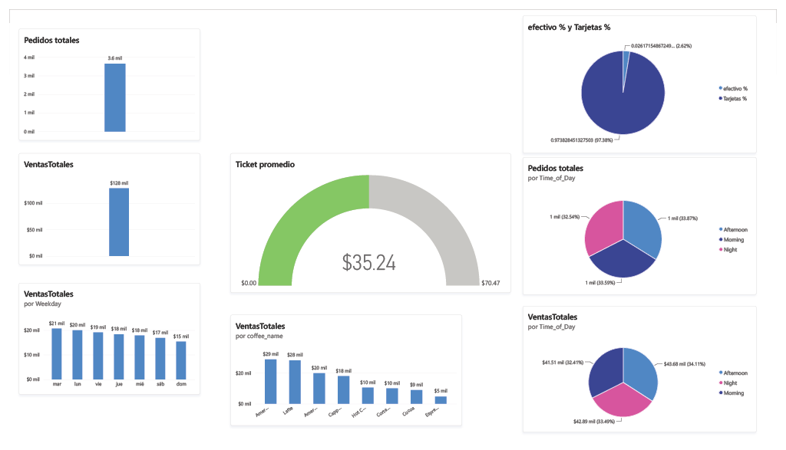
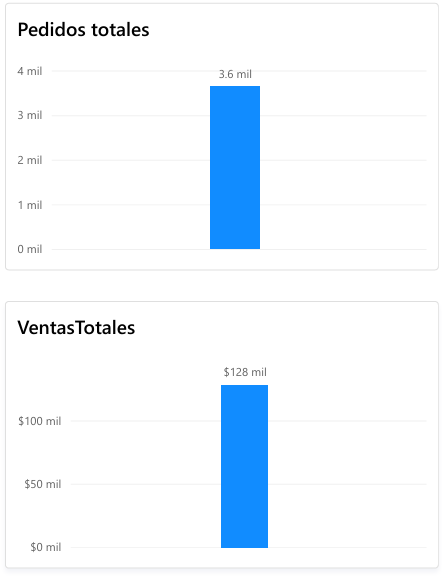
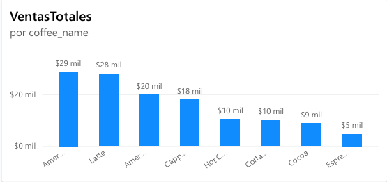
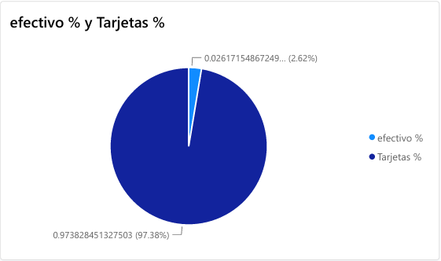
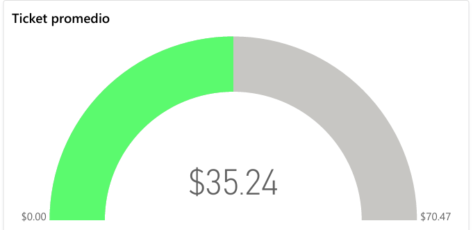

# Coffe_sales_dashboard_powerBi
Dashboard en power Bi para las ventas anuales de una cafeteria.

Este proyecto resuelve la visualización de métricas de ventas del año 2024 en una cafetería local (ficticia).

El contar con una herramienta que te permita analizar las ventas, productos y comportamiento del consumo de los clientes permite poder tomar decisiones a futuro para el negocio y aumentar ganancias.
## Datos

El dataset original que se utilizó como base para este proyecto es el del usuario. **Richard Chinyamgue** <a url="https://www.kaggle.com/datasets/reignrichard/coffee-store-sales">dataset original</a>.
El dataset fue modificado para poder realizar el cálculo de métricas más apegado a los objetivos requeridos. Entre los cambios realizados estuvieron:
* Conversión de moneda sudafricana a peso mexicano.
* Agregar *IDs* a cada venta para poder calcular cosas como los pedidos.
* Tipado de datos para poder usarlos de manera eficiente en *Power Bi*.

## Resultados obtenidos de los datos 

Las métricas y resultados obtenidos son respecto a todos los datos recopilados, que son datos obtenidos desde enero hasta diciembre del 2024.

En todo el periodo que se registró, se obtuvieron un total de tres mil seiscientos con ventas totales poco más de ciento veintiocho mil.

---

En esta métrica podemos observar dos datos importantes: la popularidad de los productos totales y cuántas ventas registró cada producto por sí mismo.

---

La gran mayoría de los métodos de pago utilizados fueron por medio de tarjeta, representando arriba del **97%**.

---

El cliente en promedio realizó compras por este monto en promedio.

### Herramientas usadas:

* Power BI.
* DAX.
* Power Query.
* Excel.
